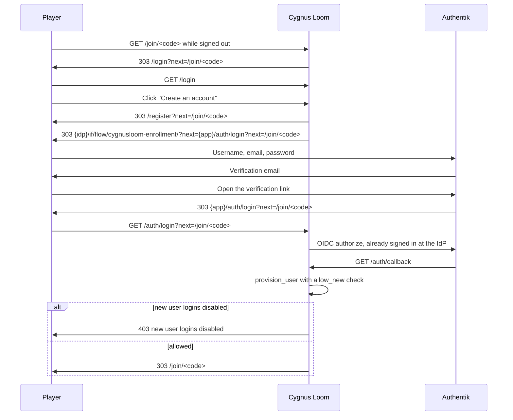

# Player registration plan

Status: planned, not implemented. Working design and implementation plan for self-service player
accounts.

## Current state

Cygnus Loom delegates every credential to Authentik. `/login` only starts the OIDC flow, and
`provision_user` mirrors a verified identity into the local `user` table on the first callback.
There is no `/register` route, no signup link, and no way for a new player to create an account
without an administrator doing it in Authentik.

- `src/cygnusloom/web/accounts.py` has `/login` and `/auth/login`, but no registration entry.
- `src/cygnusloom/services/accounts.py` creates the local account from OIDC claims; the app never
  stores passwords.
- `deploy/authentik/README.md` documents manual account creation under "Add a player".
- The app has no gate on first-time OIDC provisioning: any new IdP identity gets a `User` row on
  its first successful callback, including a Google user who never visited a signup page.
- The admin console has no registration or new-user-login setting. The toggle needs a small
  database-backed config table; today's admin configuration is limited to accounts, campaigns,
  models, and audit.
- The compose stack runs Authentik 2026.5.3. The blueprint creates `cygnusloom-admins`,
  `cygnusloom-credit-exempt`, the OIDC provider, and the application, but no enrollment flow.
- The application has no policy binding, so any identity from the configured issuer can sign in.
  The IdP's account creation is the real gate.
- `_login_redirect` already sends a signed-out visitor from `/join/<code>` to
  `/login?next=/join/<code>`, and the login page preserves that path.
- `User.credit_balance` defaults to 0. New accounts can join somebody else's campaign for free;
  owning a campaign needs credits because the owner pays for AI GM replies.
- The compose stack has no SMTP settings, so email verification cannot work out of the box.
- The single-player edition uses a local account and is unaffected.

## Goals

- Let a new player create an account through Authentik without an administrator, when the
  deployment offers a signup URL.
- Keep signup availability in Authentik. Cygnus Loom only advertises signup when
  `CYGNUSLOOM_OIDC_SIGNUP_URL` is configured.
- Add an admin toggle that allows or blocks new user logins. It is disabled by default and also
  blocks first-time Google users.
- Use email verification for the default enrollment flow.
- Support deployments without SMTP: ship an enrollment flow with no email stage, and document a
  Google source for operators who prefer a verified external identity.
- Add a "Create an account" entry point to `/login` whenever the signup URL is configured.
- Make the campaign share link a registration funnel: a new player opens `/join/<code>`, creates
  an account, and lands back on the join page.
- Keep credentials, password reset, MFA, and roles in Authentik. Cygnus Loom adds no credential
  storage and no user table migration; the only schema change is a one-row registration setting.
- Start every new account at 0 credits.
- Ship a blueprint and documentation; do not call the Authentik API from the app.

## Non-goals

- Local email/password registration or password storage in Cygnus Loom.
- A signup enable/disable toggle in Cygnus Loom. Signup availability is an Authentik flow
  decision; Cygnus Loom only checks `CYGNUSLOOM_OIDC_SIGNUP_URL`. The Cygnus toggle is about new
  user logins, not account creation at the IdP.
- App-managed user creation, invitations, or SCIM.
- Invite-only registration and an admin approval queue in this phase. The new
  `cygnusloom-players` group leaves both possible later.
- Shipping a Google or other social source in the blueprint. The plan documents it as an operator
  option because it needs an external client id and secret.
- CAPTCHA, terms acceptance, an age gate, and self-service account deletion. Email verification is
  the only anti-abuse control in this phase; the others remain operator options or future work.
- Credit grants, pricing changes, or the payments flow. New accounts simply start at 0.

## Decisions

- **Two layers.** Authentik controls whether an account can be created. Cygnus Loom controls
  whether a new IdP identity can provision a local account on first sign-in. Either layer can
  reject a new player; both are needed to close registration completely.
- **No signup toggle in Cygnus Loom.** The login page advertises signup whenever
  `CYGNUSLOOM_OIDC_SIGNUP_URL` is set. Clearing the variable stops advertising and makes
  `/register` return 404. Whether the flow is open is an Authentik decision.
- **New user logins are off by default.** A single `registration_config` row stores
  `allow_new_users`. No row means disabled, so an upgraded database starts closed. Existing
  accounts always sign in; a new identity carrying the administrator role is allowed so the
  first administrator can bootstrap.
- **Two shipped flows.** `cygnusloom-enrollment` includes the email stage;
  `cygnusloom-enrollment-open` is the same flow without it. Operators without SMTP point the
  signup URL at the open flow. A Google source can provide verified email instead.
- **Signup entry points are `/login` and campaign join links.** `/register` is a thin redirect
  route driven only by the signup URL that preserves a safe `next` path through the IdP flow.
- **New accounts start at 0 credits.** Joining a campaign someone else owns is free. Starting a
  campaign still requires a model and enough credits for the owner's turns.
- **Blueprint plus an app signup link, no Authentik API.** The app never creates, invites, or
  modifies IdP users. The URL is configuration, not a hard-coded Authentik call.
- **One new group, no application policy binding yet.** Enrollment adds accounts to
  `cygnusloom-players` so administrators can see players and a future approval mode has a target.
  The application is not bound to that group in this phase, because doing so would lock out every
  existing account that is not in the group. Binding the app to the group is the switch for a
  future invite-only or approval mode.
- **The signup URL is the only new Cygnus Loom environment variable.** `CYGNUSLOOM_OIDC_SIGNUP_URL`
  points at the verified or open Authentik flow, or at another provider's registration page.
  There is no signup enable flag and no derived Authentik URL. The optional
  `AUTHENTIK_EMAIL__*` keys configure Authentik's mailer; the app never reads them.
- **One small table and migration.** `registration_config` holds the new-user-login toggle.
  `User` already stores the issuer, subject, email, roles snapshot, credit balance, and disabled
  flag, so there is no user-table migration and no credential storage.
- **The new-login toggle gates provisioning, not the IdP.** It rejects a first-time identity
  before a `User` row is created, including a Google user who already has an IdP account.
  Existing accounts are unaffected. Signup can still be enabled at Authentik while Cygnus Loom
  rejects the resulting first login; the login page and the admin page say so.
- **Full closure uses both switches when the IdP has its own signup control.** Disable the
  enrollment flow in Authentik, turn off new user logins in Cygnus Loom, and clear the signup URL
  so the login page stops advertising. With another IdP, close its registration flow and turn
  off new logins here.

## Registration flow

Before the first registration, an administrator enables the enrollment flow in Authentik, sets
`CYGNUSLOOM_OIDC_SIGNUP_URL`, and turns on "Allow new user logins" in `/admin/registration`.
The new-login setting is off by default. Advertising and new-login allowance are independent:
a signup URL with new logins off lets a player enroll at Authentik but rejects the first
Cygnus Loom sign-in.

1. A signed-out visitor opens a campaign share link and is sent to `/login` with the join path as
   `next`.
2. The login page shows "Continue with {provider}" and, when `CYGNUSLOOM_OIDC_SIGNUP_URL` is
   set, "Create an account".
3. The signup link goes to `/register?next=...` in the app. It validates `next` with `_safe_next`,
   then redirects to the IdP enrollment flow. The flow's `next` parameter is the app's
   `/auth/login` URL with the same `next` path.
4. Authentik creates the account, optionally verifies the email, signs the new user in at the IdP,
   and redirects back to `/auth/login`.
5. `/auth/login` starts the normal OIDC authorization request. Because the user already has an
   IdP session, the callback returns without another prompt.
6. `provision_user` sees a new identity. If new user logins are off and the identity has no
   administrator role, the callback rejects the sign-in with a message and creates no row. When
   allowed, it creates the account with 0 credits and no app roles, then redirects to the saved
   `next`, which is the campaign join page.
7. The player clicks "Join campaign" and creates a character. No credits are needed to play in
   somebody else's campaign.

A signup URL with new user logins off is a supported but confusing state: the player completes
enrollment and is then refused. The admin page warns about it.

A player who starts at `/login` without a `next` path lands on `/campaigns` after enrollment. An
existing player uses the normal "Continue with {provider}" button; the signup link does not
replace it.

If Authentik drops the `next` parameter during enrollment, the live test catches it. The fallback
is to land on `/login` and ask the player to reopen the share link; the flow must not silently
sign the player into the wrong campaign.

## Authentik blueprint

Add to `deploy/authentik/blueprints/cygnusloom.yaml`:

- **Group `cygnusloom-players`.** Every self-enrolled account joins it through the user-write
  stage. It is not an app role (the admin claim stays `groups` matched against
  `CYGNUSLOOM_ADMIN_VALUES`).
- **Prompt stage `cygnusloom-enrollment-prompt`.** Fields: username (required), email (required),
  name (display name), password.
- **Email stage `cygnusloom-enrollment-email`.** Uses Authentik's global email settings, verifies
  the address, and activates the user on success. Token lifetime uses the Authentik default.
- **User-write stage.** Creates the user and adds it to `cygnusloom-players`.
- **User-login stage.** Signs the new user in at the IdP so the OIDC round trip can finish.
- **Flow `cygnusloom-enrollment`.** Public (no authentication required), bound in order:
  prompt, email, user-write, user-login.
- **Flow `cygnusloom-enrollment-open`.** The same stages without the email stage. Operators who
  cannot configure SMTP point `CYGNUSLOOM_OIDC_SIGNUP_URL` at this flow.
- **Signup availability stays in Authentik.** The blueprint only creates the flow; it does not
  add a Cygnus Loom setting for it. Authentik controls flow access with policy bindings rather
  than an enabled checkbox. To close signup, add a deny policy binding to the flow (or remove
  the flow's entry point) and clear `CYGNUSLOOM_OIDC_SIGNUP_URL` so the app stops advertising.
  The blueprint does not manage that deny binding, so `scripts/update.sh` leaves it in place;
  deleting the flow alone is not durable because the blueprint re-creates it.
- **Leave the identification stage alone by default.** The Cygnus Loom `/login` page is the
  advertised entry point. An operator can add the flow to Authentik's login page if they want a
  second entry point, but it is outside the Cygnus Loom settings.
- **No application policy binding yet.** Existing accounts must not lose access. The group is
  visible in **Directory > Groups** and can later be bound to the application for approval or
  invite-only modes.

`scripts/update.sh` already re-applies the blueprint after `docker compose up`, so existing
installations gain the new objects. Verify under **System > Blueprints** if the flow is missing.

## Email verification and no-SMTP deployments

The verified flow needs Authentik's global email settings. These are IdP settings, not Cygnus
Loom settings: the app never reads them. Add commented keys to `.env.example` and pass them to
both `authentik-server` and `authentik-worker` through the shared environment anchor in
`compose.yaml`:

- `AUTHENTIK_EMAIL__HOST`
- `AUTHENTIK_EMAIL__PORT`
- `AUTHENTIK_EMAIL__FROM`
- `AUTHENTIK_EMAIL__USE_TLS`
- `AUTHENTIK_EMAIL__USE_SSL`
- `AUTHENTIK_EMAIL__USERNAME`
- `AUTHENTIK_EMAIL__PASSWORD`
- `AUTHENTIK_EMAIL__TIMEOUT`

`scripts/setup_env.py` does not prompt for SMTP. New installations can set the keys in `.env`
after setup; `deploy/authentik/README.md` explains getting an app password from a mail provider.

Operators without SMTP have two supported paths:

1. **Open flow.** Point `CYGNUSLOOM_OIDC_SIGNUP_URL` at `cygnusloom-enrollment-open` and leave
   the flow enabled in Authentik. Do not add the flow to the identification stage; the app
   remains the advertised entry point. Accounts have unverified emails. This is acceptable for a
   private or trusted deployment but weakens abuse protection.
2. **Google source.** Add a Google OAuth source in Authentik and a source-enrollment flow that
   adds users to `cygnusloom-players`. Google supplies a verified email, so the email stage is
   unnecessary. The Cygnus Loom login page needs no change; Authentik shows the source on its
   login screen. A first-time Google user has no Cygnus Loom row, so the new-user-login toggle
   still applies. It needs a Google OAuth client id and secret and is documented, not shipped in
   the blueprint.

Do not bind the application to `cygnusloom-players` until existing accounts are added to the
group. An operator who wants approval or invite-only later can bind the app and change the
user-write stage to a pending group; that is out of scope here.

## App changes

### Settings

Add one setting in `src/cygnusloom/config.py`:

- `oidc_signup_url: str = ""` from `CYGNUSLOOM_OIDC_SIGNUP_URL`. The explicit enrollment flow or
  registration page URL. It covers the Authentik verified and open flows and any other provider.
  A blank value hides the signup link and makes `/register` return 404.

There is no `CYGNUSLOOM_OIDC_SIGNUP` environment variable and no derived Authentik URL. Whether
the flow is open is controlled in Authentik; the URL only decides whether Cygnus Loom advertises
it.

The single-player edition ignores the setting and never shows a signup link.

### Admin setting and data model

- Add `RegistrationConfig` to `src/cygnusloom/db/models.py`:
  - `id` primary key, always 1.
  - `allow_new_users: bool = False`.
  - `updated_at: datetime` and `updated_by: int | None` (the administrator's user id).
- Add a migration after the current head (0008 today) that creates `registration_config`. Absence
  of a row means new user logins are disabled; do not seed an enabled row.
- Add `src/cygnusloom/services/registration.py`:
  - `allows_new_users(engine) -> bool`: false when there is no row.
  - `set_allow_new_users(engine, admin, enabled, *, ip) -> None`: upsert the single row and write
    an `AdminAudit` entry with `action="registration.updated"`,
    `target_type="registration"`, and `details={"allow_new_users": enabled}`.
- Add `/admin/registration` in `src/cygnusloom/web/admin.py`:
  - `GET` shows the new-user-login toggle, the configured signup URL (read-only), and the
    two-layer explanation.
  - `POST` requires `require_recent_auth`, `verify_csrf`, and an administrator. It does not
    require the signup URL: Google and manually created IdP users can sign in without it.
  - Warn when the signup URL is set but new user logins are off (players can enroll but are
    rejected) and when new logins are on but the URL is blank (new IdP accounts can sign in
    without an advertised signup page).
  - Add a "Registration" entry to `admin/nav.html`.
- Read `allows_new_users()` in the OIDC callback, not on every page. Do not cache it in
  `app.state`; a second process or a restart would otherwise keep a stale value.

### New-user provisioning gate

- `provision_user(engine, claims, *, allow_new: bool)`: the flag is required so a new caller
  cannot bypass the gate by accident.
  - Look up the existing `issuer` + `subject` first.
  - An existing account is refreshed and signed in regardless of the setting.
  - A missing account with `allow_new=False` raises `NewUserLoginsDisabled` before any row is
    created.
- In `auth_callback`, compute
  `allow_new = allows_new_users(engine) or has_admin_role(claims.roles, settings.oidc_admin_values)`.
  The administrator exemption lets the bootstrap administrator sign in on a fresh database.
- Catch `NewUserLoginsDisabled` and show `_login_page` with status 403 and a message such as
  "This server is not accepting new accounts. Ask an administrator to enable new user logins."
- The development test login (`get_or_create_test_user`) is not gated; it is disabled in
  production.

### Rendering

The signup link only appears on the login page, so `_login_page` passes `signup_url` (from
`settings.oidc_signup_url`) to `auth_form.html`. It does not read the new-user-login setting;
the URL alone decides whether signup is advertised.

### Route and template

- Add `GET /register` in `src/cygnusloom/web/accounts.py`:
  - 404 when SSO is not configured or the signup URL is blank. Do not check the new-user-login
    setting; signup advertising is URL-driven.
  - A signed-in user is redirected to the safe `next` path (default `/campaigns`).
  - Validate `next` with the existing `_safe_next`; unsafe or absolute paths fall back to
    `/campaigns`.
  - Redirect 303 to the signup URL with `next={base_url}/auth/login` plus
    `?next={quote(next_path)}` when a non-default path is present. Use `urlencode`/`quote`, not
    string concatenation.
- Update `src/cygnusloom/web/templates/auth_form.html`:
  - Under the SSO button, show "New here? Create an account" when `signup_url` is set.
  - The link targets `/register` with the current `next_path` encoded.
  - Keep the existing "Manage your account" link and the development login block unchanged.
- `_login_page` passes the signup URL to the template. Keep the template free of hand-built
  query strings.

No changes to the `User` model or the session model. The callback changes only to enforce the
new-user-login gate; it already reads `oidc_next` before `sign_in` clears the session.

### Credits

No code change. `User.credit_balance` starts at 0. A new player can join and play in somebody
else's campaign immediately; creating their own campaign is blocked from spending when the owner
cannot afford the model, exactly as today. An administrator grants credits from the admin user
page, and the payments plan adds self-service purchases later.

### Security

- The app still trusts only the configured issuer. Registration does not add an app-side identity
  source.
- Email verification is the only anti-abuse control in scope. CAPTCHA and approval can be added to
  the Authentik flow later without app changes.
- The app's `/auth/callback` rate limiter remains. Authentik's own brute-force and reputation
  policies protect the enrollment flow.
- `/register` only redirects; it stores nothing and sets no cookie beyond the existing session.
  The safe-`next` check prevents the app from becoming an open redirect.
- The new-user-login gate is a provisioning boundary, not an IdP boundary. It rejects a new
  identity before creating a `User` row, including a first-time Google user. Existing accounts
  still sign in. Signup can still be open at Authentik while Cygnus Loom refuses the resulting
  first login.
- The signup URL is advertising only. Setting or clearing it does not enable or disable the
  Authentik flow. Full closure means disabling the flow in Authentik and turning off new user
  logins here.
- The administrator-role exemption means anyone who can join the configured admin group can
  provision an account while new logins are off. Keep the Authentik admin group small.
- SMTP credentials live only in Authentik's environment. No new secrets reach the app.
- A disabled local account still fails with `AccountDisabled`. Deactivating an account in
  Authentik blocks it at the IdP first.
- Changing an email in Authentik keeps the same `issuer` + `subject`, so the account is not
  duplicated; `provision_user` refreshes the stored email on the next sign-in.
- The open flow creates unverified addresses. Document that it is for trusted deployments and
  that it cannot prevent account spam; the 0-credit default limits AI spend but not account
  clutter.

## Testing

Automated tests:

- `tests/test_auth.py`:
  - Signup advertising is URL-driven: `/login` has no create-account link and `/register` is 404
    when `CYGNUSLOOM_OIDC_SIGNUP_URL` is blank.
  - With the URL set, `/login` shows the link and `/register` 303s to it, chaining `next`
    through `/auth/login`, regardless of the new-user-login setting.
  - An unsafe `next` (`//evil.example`, `https://evil.example`) is replaced with `/campaigns`.
  - A new OIDC identity is rejected with 403 and creates no `User` row when new user logins are
    off. Existing accounts still sign in.
  - A new identity with an administrator role is provisioned when new user logins are off.
  - Enabling new user logins provisions a new non-admin identity.
  - The existing `test_oidc_login_creates_account` enables the setting explicitly.
  - SSO missing and single-player mode never show the link.
- `tests/test_admin.py`:
  - `/admin/registration` requires an administrator, recent auth, and CSRF.
  - The toggle writes the row and an `AdminAudit` entry.
  - The toggle does not require the signup URL to be set.
  - The default state on a fresh database is disabled.
- `tests/test_migrations.py`: the new table exists and absence of a row means disabled.
- `tests/test_deploy_scripts.py`:
  - The blueprint contains `cygnusloom-players`, both enrollment flows, the email stage in the
    verified flow and its absence from the open flow.
  - The blueprint does not change the identification stage.
  - `.env.example` documents `CYGNUSLOOM_OIDC_SIGNUP_URL` and the Authentik email keys, and does
    not add a signup enable variable.
  - The application still has no new policy binding in this phase.
- If a local mail catcher is added, keep it out of the production compose files.

Live verification:

1. Start the full stack and apply the blueprint. Use the open flow or a Mailpit-style SMTP sink.
2. Sign in as an administrator. The admin-role exemption allows the first login while new user
   logins are off. Confirm `/admin/registration` starts closed, then enable new user logins and
   set `CYGNUSLOOM_OIDC_SIGNUP_URL`.
3. In a private browser, open a campaign share link. Confirm the redirect to `/login` with the
   join path, the create-account link, and the enrollment form.
4. Enroll with a new email. Confirm the redirect chain returns to the join page.
5. Join the campaign, create a character, and confirm the player can act without credits.
6. In the database, confirm the new `user` row has 0 credits, no admin role, and the expected
   issuer and subject. In Authentik, confirm the account is in `cygnusloom-players`.
7. Add the account to `cygnusloom-admins`, sign in again, and confirm the Admin link appears.
8. Sign out and sign in through "Continue with {provider}" as the same account; confirm no
   duplicate user row.
9. With the verified flow, confirm the email arrives, the link completes enrollment, and an
   expired or reused link is rejected.
10. Turn off new user logins. Confirm a first-time non-admin OIDC identity is rejected and an
    existing account still signs in.
11. If a Google source is configured, repeat the check with a first-time Google identity; it is
    rejected while new user logins are off and provisioned when they are on.
12. Disable the enrollment flow in Authentik, clear `CYGNUSLOOM_OIDC_SIGNUP_URL`, and confirm
    the login page no longer advertises signup and `/register` is 404.

## Docs

- `deploy/authentik/README.md`:
  - Replace the primary "Add a player" instructions with "Let players create their own accounts".
  - Keep manual creation as the fallback for closed deployments and troubleshooting.
  - Document the verified and open flows, SMTP settings, and the Google source alternative.
  - Explain the two layers: Authentik controls account creation, and `/admin/registration`
    controls whether a new IdP identity can sign in. The Cygnus toggle starts closed; the
    Authentik flow is enabled or disabled by the operator.
  - Note that onboarding a manually created IdP player also needs the new-user-login toggle
    turned on for their first sign-in; it can be turned off again afterward.
  - Explain that `CYGNUSLOOM_OIDC_SIGNUP_URL` only advertises signup and must be cleared to stop
    the login-page link. There is no enable environment variable.
  - Add an upgrade note: the blueprint adds the group and flows; existing accounts are unaffected
    because the app is not bound to the group.
- `README.md`: mention that an administrator enables new user logins, the signup link appears
  when the signup URL is configured, new accounts start at 0 credits, and joining someone else's
  campaign is free.
- `.env.example`: add the optional Authentik email keys and the single
  `CYGNUSLOOM_OIDC_SIGNUP_URL` app setting with safe comments. Do not add a signup enable
  variable.
- `docs/REGISTRATION_PLAN.md`: this file.

## Suggested implementation order

1. Data and admin: `RegistrationConfig`, migration, registration service,
   `/admin/registration`, nav entry, audit, and tests. The default is disabled.
2. Provisioning gate: `provision_user(..., allow_new=...)`, the callback check, the admin-role
   exemption, and the auth tests.
3. Signup entry: `CYGNUSLOOM_OIDC_SIGNUP_URL`, `/register`, login template link, and the auth
   tests.
4. Blueprint: players group, prompt/write/login stages, verified and open flows. Do not change
   the identification stage. Add the deploy-script assertions.
5. Email environment: pass the Authentik email keys through `compose.yaml`, document them in
   `.env.example`, and update the Authentik README.
6. Docs and live verification: README, Authentik README, join-funnel E2E, and the credit and
   admin checks.
7. Optional: a local-only mail catcher in `compose.local.yaml` for testing the verified flow
   without a real mail provider.

## Future work

- Bind the application to `cygnusloom-players` and add a pending group for admin approval.
- Invite-only enrollment using Authentik's invitation stage, optionally minted from campaign share
  links through the Authentik API.
- CAPTCHA, terms acceptance, and an age gate on the enrollment flow.
- A welcome credit grant if the product decides new accounts should be able to start a campaign
  before buying or receiving credits.
